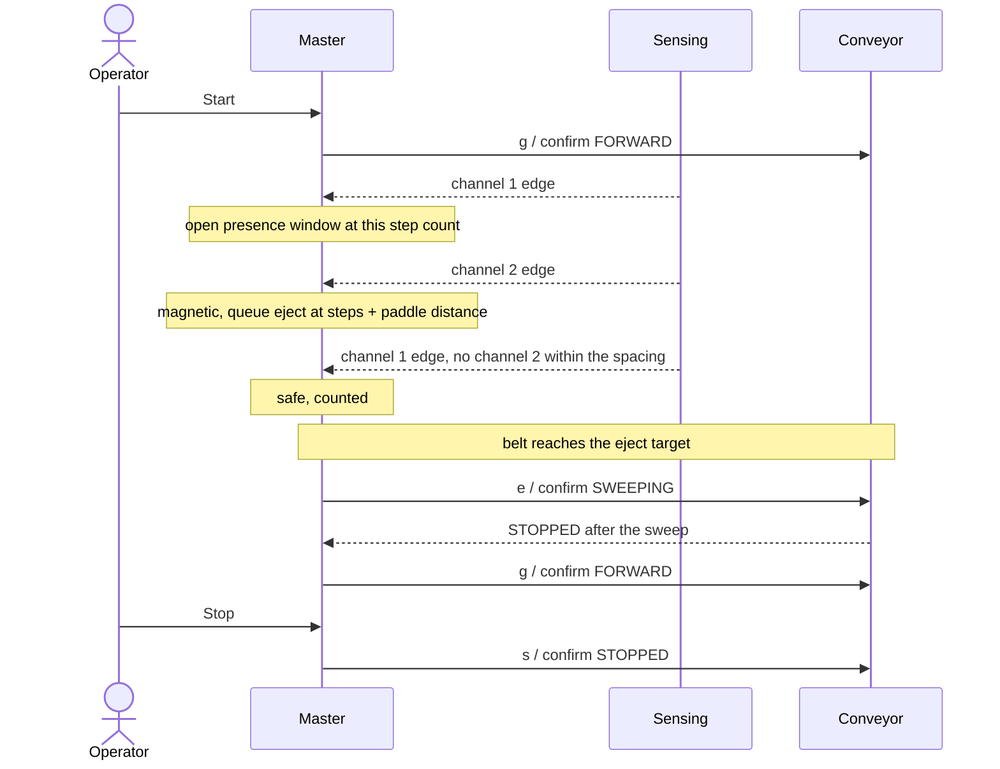

# Shared contract — v4 design

This file defines the external interface. `shared/contract.h` carries the same numbers as named constants for all three boards; change both together. Subsystem READMEs explain local work; they do not override these rules. Use Arduino Wire without another messaging library, CRC, sessions or command IDs.

## Ownership

Slaves report what they measure and what they are doing. The master gives those readings their meaning. No slave holds process state, so no slave is told about the process.

| Board | Owns | Reports | Accepts |
| --- | --- | --- | --- |
| Conveyor | Stepping, the ejector paddle, cumulative step count, its contact watchdog | Motion state, fault, uptime, steps | `g`, `s`, `e`; `b` for bench use |
| Sensing | Debounce, cumulative edge count per channel, its contact watchdog | Health, fault, uptime, live mask, two edge counts, two signal levels | Nothing |
| Master | Puck classification, the eject queue, counters and system fault; operator Serial; the only andon | Serial report and andon | `start`, `stop`, `resume` |

## Agreed operation

Channel 1 is a light sensor that sees every puck. Channel 2 is a Hall sensor about 30 mm further along that sees only magnetic pucks. The belt runs continuously from Start until Stop. Each channel 1 edge opens a presence window. A channel 2 edge inside the oldest open window classifies that puck as magnetic; a window that reaches the channel spacing allowance without one classifies the puck as safe. Every magnetic puck is queued for ejection at its channel 2 step count plus the paddle distance; when the belt reaches that count the master commands one paddle sweep, the belt pauses for the sweep, then continues. Several pucks may be on the belt; ejects happen in arrival order.

A channel 2 edge with no window open is still magnetic and still ejected; the master counts it as unmatched so the operator can see that the light sensor missed one. Nothing about puck spacing is a fault. Operator Stop pauses the belt and keeps the windows, the queue and the counters; Resume continues. Counters persist until the master is reset. Missing feedback, invalid replies, a slave fault, unexpected motion or an unconfirmed sweep cause a latched master FAULT. Remove the pucks and reset the master to clear it.

## Wire format

The master initiates every transaction. A command is two bytes: the ASCII command byte followed by its bitwise complement. A slave ignores any write that is not exactly that pair, so a noise burst on the bus cannot form a command. Status is a separate read. Addresses are 7-bit. Unknown commands, writes without a matching complement and failed guards have no effect. An ACK confirms delivery, not action completion. Confirm actions by polling.

| Board | Address | Reply length | State byte values |
| --- | --- | --- | --- |
| Conveyor | `0x10` | 10 bytes | 0 STOPPED, 1 FORWARD, 2 REVERSE, 3 FAULT, 4 SWEEPING |
| Sensing | `0x11` | 15 bytes | 0 OK, 1 FAULT |

| Offset | Field | Definition |
| --- | --- | --- |
| 0, both | state: uint8 | Board-specific value above. |
| 1, both | fault: uint8 | 0 NONE, 1 CONTACT_LOST, 2 LOCAL. |
| 2–5, both | uptime_ms: uint32 | Main-loop snapshot of milliseconds since boot. |
| 6–9, conveyor | issued_steps: uint32 | Total emitted library steps in either direction since boot. |
| 6, sensing | live_mask: uint8 | Debounced input bits: bit 0 channel 1, bit 1 channel 2. Other bits zero. |
| 7–8, sensing | channel1_edges: uint16 | Debounced closing edges on channel 1 since boot. |
| 9–10, sensing | channel2_edges: uint16 | Debounced closing edges on channel 2 since boot. |
| 11–12, sensing | channel1_level: uint16 | Diagnostic: channel 1 signal level in the board's own units. The master only displays it. |
| 13–14, sensing | channel2_level: uint16 | Diagnostic: channel 2 signal level. The master only displays it. |

Channel 1 is the presence sensor and channel 2 the magnetic sensor. The sensing board does not know what either edge means; the master pairs them.

Multi-byte fields are little-endian. Send numeric bytes, not ASCII digits. Serialize explicitly; do not transmit a C++ struct. Publish coherent snapshots from the main loop at least every 20 ms. FAULT requires a nonzero fault; healthy states require zero. Preserve the first fault reason.

Counters only increase and wrap naturally. The master compares them with saved baselines using unsigned subtraction and keeps every limit below half the counter range. Step delta divided by calibrated steps per millimetre estimates travel; it is not position feedback. Slips, stalls and actual ejection are not verified.

## Conveyor commands

| Command | Legal behaviour |
| --- | --- |
| `g` | STOPPED → FORWARD. Already FORWARD: no-op. REVERSE or FAULT: ignore. |
| `b` | STOPPED → REVERSE. Already REVERSE: no-op. FORWARD or FAULT: ignore. |
| `s` | Stop issuing steps. STOPPED, FORWARD or REVERSE → STOPPED. SWEEPING and FAULT: ignore. |
| `e` | STOPPED or FORWARD → SWEEPING: stop the belt and run one paddle sweep out and back. REVERSE, SWEEPING or FAULT: ignore. Back to STOPPED when the paddle has returned. |

A direction change requires confirmed STOPPED first. The master never sends `b` in v3; it stays for bench use. No speed command exists. Standalone Serial bench controls must not compete with master commands.

## Slave watchdog and faults

After the first status read, no status read for 1,000 ms causes a local FAULT with CONTACT_LOST: the conveyor stops stepping and reports FAULT, the sensing board reports FAULT. When reads resume, the board clears CONTACT_LOST on its own: the conveyor returns to STOPPED and never resumes motion by itself; the sensing board returns to OK. This lets a master reset recover the system. LOCAL covers any fault the board detects in its own hardware; it latches until that board is reset. The master never writes a fault into a slave.

## Master rules

1. Boot: request stop. Require fresh conveyor STOPPED, sensing OK and both channels open before READY. Absent slaves wait without fault.
2. Poll sensing then conveyor every 100 ms in every master state.
3. Send a motion command once. Confirm it only from a reply received after it was sent, within 300 ms. Retry only `s`, once per poll, until confirmed. Never extend the original deadline. `e` is confirmed by SWEEPING within 300 ms; the sweep must end in STOPPED within 6,000 ms.
4. Mark feedback UNKNOWN after 300 ms without a valid reply. Invalid length, values or reserved bits cause FAULT during a cycle; in INITIALISING, READY or BENCH they only block progress, because a bus being wired produces them. A counter that decreases without a detected reboot counts as invalid. UNKNOWN during a cycle causes FAULT; UNKNOWN in the idle states only blocks progress. A slave reporting CONTACT_LOST in the idle states also only blocks progress, because the next reads clear it; any other slave fault, in any state, causes FAULT.
5. Fault if returned uptime does not advance for 300 ms. A slave reboot during a cycle causes FAULT; in INITIALISING or READY it returns the master to INITIALISING.
6. Start sends `g` and begins tracking from the current edge counts. From then on every channel 1 edge opens a presence window stamped with the belt step count from the same poll. Every channel 2 edge closes the oldest open window as magnetic, or counts as unmatched if none is open, and pushes an eject target of the current step count plus the paddle distance. A window older than the channel spacing allowance closes as safe.
7. When the belt step count reaches the head of the eject queue, send `e`. Confirm SWEEPING within 300 ms and STOPPED within 6,000 ms, then pop the queue, count the eject and send `g` again. Stop during a sweep is refused and takes effect when the sweep ends.
8. Windows and eject targets are step counts, so they survive pauses unchanged. The queue holds sixteen entries; overflow is a FAULT because it cannot happen with pucks on a belt of this length.
9. Stop sends `s` each poll until STOPPED is confirmed, then PAUSED. Resume sends `g`, or `e` if an eject is already due.
10. Stop has priority over any other operator command received in the same poll interval.
11. On system fault: send `s` each poll until a post-fault reply confirms STOPPED, show red on the master andon, latch, and report STOP UNCONFIRMED until the confirmation arrives. No command clears a master fault.
12. Full reset means stop the drive as needed, remove all pucks and reset the master. Reset a slave only if it reports LOCAL.

Timing values are bench defaults, not safety guarantees. Software stop is not an emergency-stop system. Step distances are based on emitted motion; they cannot diagnose a motor that receives steps but does not move.

## Andon

The master drives the only andon. Amber blinking in INITIALISING while it waits for the slaves. Off in READY and BENCH. Green while running, stopping or sweeping. Amber steady in PAUSED. Red in FAULT, including a slave fault. Slaves have no status lights.

## Normal sequence

## Calibration and integration inputs

Measure fixed speed, step unit, steps/mm, the channel spacing allowance, the Hall-to-paddle distance, the sweep duration, debounce, sample interval and polling margin. Master-observed events are delayed by polling; account for this in calibration. Never reset a baseline on repeated replies.

The conveyor drives a 28BYJ-48 through a ULN2003 by direct half-stepping; one contract step is one half-step and the coils are released when stopped. Confirm channel/LED wiring and polarity. Use common ground, Uno SDA/A4 and SCL/A5, suitable pull-ups and a compatible motor driver/supply. Never drive coils from GPIO. Screen, buzzer, Teleplot formatting and speed control are stretch work. Actual ejection remains unverified without an additional sensor; both channels reading open after the sweep is the only evidence.
