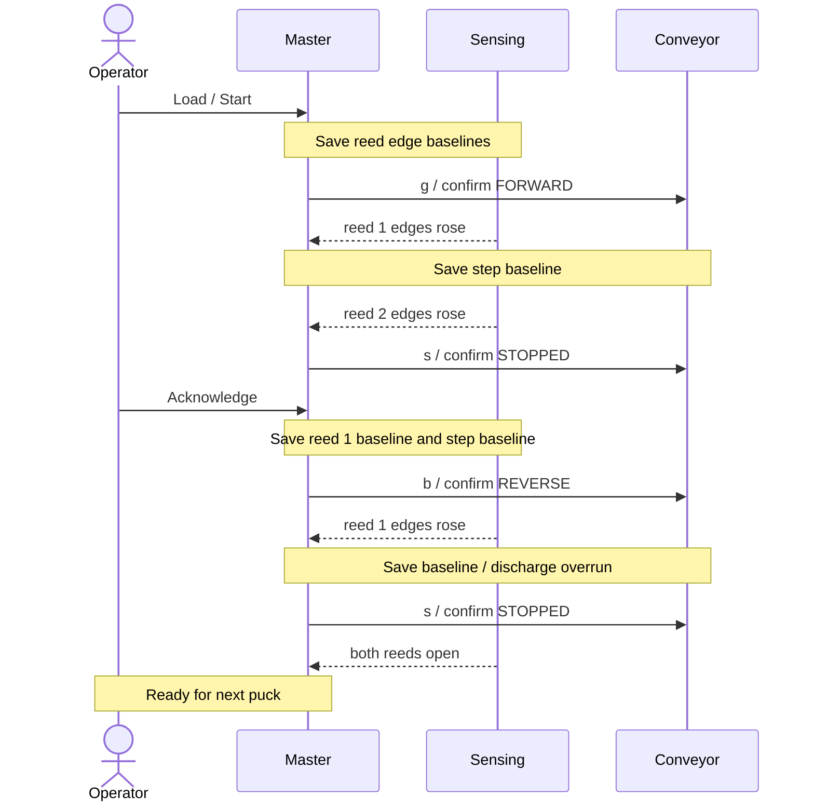

# Shared contract — v2 design

This file defines the external interface. `shared/contract.h` carries the same numbers as named constants for all three boards; change both together. Subsystem READMEs explain local work; they do not override these rules. Use Arduino Wire without another messaging library, CRC, sessions or command IDs.

## Ownership

Slaves report what they measure and what they are doing. The master gives those readings their meaning. No slave holds process state, so no slave is told about the process.

| Board | Owns | Reports | Accepts |
| --- | --- | --- | --- |
| Conveyor | Stepping, direction, cumulative step count, its contact watchdog | Motion state, fault, uptime, steps | `g`, `b`, `s` |
| Sensing | Debounce, cumulative edge count per reed, its LEDs from live reed levels, its contact watchdog | Health, fault, uptime, live mask, two edge counts | Nothing |
| Master | Every phase, baseline, allowance, acknowledgement and system fault; operator Serial; system andon | Serial report and andon | `start`, `stop`, `resume`, `ack` |

## Agreed operation

Load one puck before reed 1. Run forward. A reed 1 edge records arrival; a reed 2 edge completes magnetic detection. Stop and wait for operator acknowledgement. Then reverse until a new reed 1 edge, run a calibrated discharge overrun and stop. Prepare the next cycle only after both reeds read open.

No reed activity before arrival is normal. There is no no-detection deadline or non-magnetic classification. Operator Stop pauses the current phase. Resume preserves the phase and travel progress. Missing an expected reed causes a latched master FAULT. Remove all pucks and reset the master to clear it. Reset a slave only if it shows LOCAL. Never resume a faulted cycle.

## Wire format

The master initiates every transaction. A command is exactly one ASCII byte, without newline or NUL. Status is a separate read. Addresses are 7-bit. Unknown commands, wrong-length writes and failed guards have no effect. An ACK confirms delivery, not action completion. Confirm actions by polling.

| Board | Address | Reply length | State byte values |
| --- | --- | --- | --- |
| Conveyor | `0x10` | 10 bytes | 0 STOPPED, 1 FORWARD, 2 REVERSE, 3 FAULT |
| Sensing | `0x11` | 11 bytes | 0 OK, 1 FAULT |

| Offset | Field | Definition |
| --- | --- | --- |
| 0, both | state: uint8 | Board-specific value above. |
| 1, both | fault: uint8 | 0 NONE, 1 CONTACT_LOST, 2 LOCAL. |
| 2–5, both | uptime_ms: uint32 | Main-loop snapshot of milliseconds since boot. |
| 6–9, conveyor | issued_steps: uint32 | Total emitted library steps in either direction since boot. |
| 6, sensing | live_mask: uint8 | Debounced input bits: bit 0 reed 1, bit 1 reed 2. Other bits zero. |
| 7–8, sensing | reed1_edges: uint16 | Debounced closing edges on reed 1 since boot. |
| 9–10, sensing | reed2_edges: uint16 | Debounced closing edges on reed 2 since boot. |

Multi-byte fields are little-endian. Send numeric bytes, not ASCII digits. Serialize explicitly; do not transmit a C++ struct. Publish coherent snapshots from the main loop at least every 20 ms. FAULT requires a nonzero fault; healthy states require zero. Preserve the first fault reason.

Counters only increase and wrap naturally. The master compares them with saved baselines using unsigned subtraction and keeps every limit below half the counter range. Step delta divided by calibrated steps per millimetre estimates travel; it is not position feedback. Slips, stalls and actual ejection are not verified.

## Conveyor commands

| Command | Legal behaviour |
| --- | --- |
| `g` | STOPPED → FORWARD. Already FORWARD: no-op. REVERSE or FAULT: ignore. |
| `b` | STOPPED → REVERSE. Already REVERSE: no-op. FORWARD or FAULT: ignore. |
| `s` | Stop issuing steps. Healthy → STOPPED. FAULT stays FAULT. Discard older queued movement. |

A direction change requires confirmed STOPPED first. No speed command exists in v2. Standalone Serial bench controls must not compete with master commands.

## Slave watchdog and faults

After the first status read, no status read for 1,000 ms causes a local FAULT with CONTACT_LOST: the conveyor stops stepping, the sensing board shows red. When reads resume, the board clears CONTACT_LOST on its own: the conveyor returns to STOPPED and never resumes motion by itself; the sensing board returns to OK. This lets a master reset recover the system. LOCAL covers any fault the board detects in its own hardware; it latches until that board is reset. The master never writes a fault into a slave.

## Sensing LEDs

Green while reed 1 reads closed. Amber while reed 2 reads closed. Red while the board is in FAULT. Off otherwise. The LEDs show the local reading only. Process phase is shown on the master andon.

## Master rules

1. Boot: request stop. Require fresh conveyor STOPPED, sensing OK and both reeds open before READY. Absent slaves wait without fault.
2. Poll sensing then conveyor every 100 ms in every master state.
3. Send a motion command once. Confirm it only from a reply received after it was sent, within 300 ms. Retry only `s`, once per poll, until confirmed. Never extend the original deadline.
4. Mark feedback UNKNOWN after 300 ms without a valid reply. Invalid length, values or reserved bits cause FAULT. A counter that decreases without a detected reboot causes FAULT. UNKNOWN during a cycle causes FAULT; UNKNOWN in INITIALISING, READY or BENCH only blocks progress. A slave reporting CONTACT_LOST in those states also only blocks progress, because the next reads clear it; any other slave fault, in any state, causes FAULT.
5. Fault if returned uptime does not advance for 300 ms. A slave reboot during a cycle causes FAULT; in INITIALISING or READY it returns the master to INITIALISING.
6. Start saves both reed edge counts. Arrival is a reed 1 count above that baseline. Magnetic is a reed 2 count above its baseline. A reed 2 rise with no reed 1 rise causes REED_ORDER. Both rising in the same poll counts as magnetic.
7. At arrival, save the step baseline from the same poll. Apply the forward allowance to reach reed 2. At reverse start, save the step baseline and the reed 1 count. Apply the return allowance to reach a new reed 1 edge. Exceeding an allowance without the expected event causes FAULT in every state, including paused. An expected event seen in the same poll wins over the limit.
8. At the return edge, save the discharge-overrun step baseline from the same poll. Run the overrun, stop, confirm STOPPED and require both reeds open within 300 ms. A held reed causes FAULT. Then READY.
9. Stop saves the active phase and sends `s` each poll until STOPPED is confirmed. Then the destination is WAIT_ACK if magnetic, CLEARING if the overrun is complete, otherwise PAUSED. Resume re-evaluates the same facts before requesting motion. Baselines survive pauses.
10. Stop has priority over any other operator command received in the same poll interval.
11. On system fault: send `s` each poll until a post-fault reply confirms STOPPED, show red on the master andon, latch, and report STOP UNCONFIRMED until the confirmation arrives. No command clears a master fault.
12. Full reset means stop the drive as needed, remove all pucks and reset the master. Reset a slave only if it reports LOCAL.

Timing values are bench defaults, not safety guarantees. Software stop is not an emergency-stop system. Step allowances are based on emitted motion; they cannot diagnose a motor that receives steps but does not move.

## Master andon

Off in INITIALISING, READY and BENCH. Green while a cycle is moving or stopping. Amber in WAIT_ACK and PAUSED. Red in FAULT.

## Normal sequence

## Calibration and integration inputs

Measure fixed speed, step unit, steps/mm, reed spacing, forward/return allowances, discharge overrun, debounce, sample interval and stopping/polling margin. Master-observed events are delayed by polling; account for this in calibration. Never reset a baseline on repeated replies.

Import the working motor sketch to confirm library, driver, pins, supply, reverse support and idle-coil behaviour. Confirm reed/LED wiring and polarity. Use common ground, Uno SDA/A4 and SCL/A5, suitable pull-ups and a compatible motor driver/supply. Never drive coils from GPIO. Screen, buzzer, Teleplot formatting and speed control are stretch work. Actual ejection remains unverified without an additional sensor.
