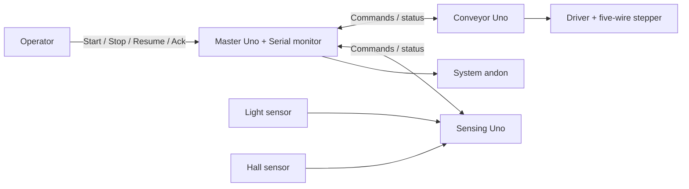

# ICTE4005 magnetic-puck conveyor

Three Arduino Unos coordinate a magnetic-puck detection and return demonstration. Pucks are loaded onto a continuously running belt. A light sensor counts every puck; a Hall sensor 30 mm later identifies the magnetic ones. Each magnetic puck is queued and ejected by a paddle sweep a calibrated distance further along; safe pucks ride through and are counted. Several pucks can be on the belt at once. This demonstrates distributed control, not material identification or verified automatic sorting.

Slaves report what they measure; the master gives it meaning. The conveyor accepts three process commands. The sensing board accepts none. Stop pauses the belt and keeps the queue and counters; Resume continues. Feedback and motion faults latch on the master; reset it to clear them. Step counting positions each puck at the paddle; the counters are the master's record, not a verified ejection.

## Boards and documents

- [Master](master/README.md): process coordination, polling, travel checks, Serial reporting and the system andon.
- [Conveyor](conveyor/README.md): fixed-speed stepper motion, the ejector paddle and issued-step feedback.
- [Sensing](sensing/README.md): light presence channel, Hall magnetic channel and edge counts.
- [Shared contract](CONTRACT.md): exact messages, state values, fault rules and calibration inputs.



## Current implementation

All three boards have firmware. The master is complete and host-tested against the real slave logic; see [master/README.md](master/README.md). The conveyor carries the proven half-step motor driver; the sensing board carries the Hall front end. Pins and tuning in each board's `main.cpp` must match the assembled wiring before uploading.

`shared/contract.h` holds every number from `CONTRACT.md` as named constants. `shared/slave_link.h` is the Wire slave boilerplate both slaves use. All three projects include the shared folder.

## PlatformIO

Open [icte4005.code-workspace](icte4005.code-workspace) or an individual board folder in VS Code. Each folder has its own `platformio.ini` and `src/main.cpp`, targeting classic Uno/R3 (`uno`, Arduino framework, AVR platform 5.0.0).

```sh
pio run -d master
pio run -d conveyor
pio run -d sensing
pio device list
pio run -d conveyor -t upload --upload-port /dev/cu.YOUR_BOARD
pio device monitor -d conveyor --port /dev/cu.YOUR_BOARD --baud 9600
```

Replace the project and port as needed. No upload port is hard-coded. The master uses 115200 baud; the scaffolds use 9600. `pio test -d master -e native` runs the master's host tests on the Mac. When importing an `.ino` into `main.cpp`, add `Arduino.h` and required forward declarations; keep one `setup()` and `loop()` per project. Add actual external libraries to that project's `lib_deps` and preserve proven pins and baud rate.

Validation on 12 October 2026: all three projects compile with the standard PlatformIO AVR toolchain, and the master host tests pass, including end-to-end runs against the slave logic. No hardware upload, I2C integration or mechanical operation is verified.

## Scope and remaining work

V4 uses fixed speed, a light sensor and a Hall channel, an ejector paddle, a master andon and a Serial operator interface. A screen showing the report is stretch work. Screen, buzzer, Teleplot formatting and adjustable speed are stretch work. No non-magnetic classification or automatic no-detection timeout is included. Uptime supports feedback diagnostics; issued steps support estimated travel.

The operating sequence is agreed. Remaining inputs are the working motor sketch, hardware/library details and measured calibration values. Each subsystem README defines its owner's deliverables and verification evidence. Protocol rules belong in the shared contract; local implementation details belong in subsystem READMEs; project scope belongs here.
