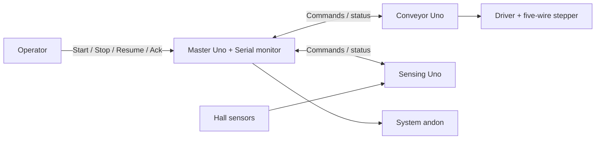

# ICTE4005 magnetic-puck conveyor

Three Arduino Unos coordinate a magnetic-puck detection and return demonstration. Load one puck before the sensing station. A channel 1 edge records arrival; a channel 2 edge causes a magnetic-detection stop. After operator acknowledgement, reverse until a new reed 1 edge and run a calibrated discharge overrun. Then stop and prepare the next cycle. This demonstrates distributed control, not material identification or verified automatic sorting.

Slaves report what they measure; the master gives it meaning. The conveyor accepts three commands. The sensing board accepts none. No reed activity means continue until the operator stops. Stop pauses the phase; Resume retains progress. Missing an expected reed causes a latched master fault. Remove all pucks and reset the master before a new cycle. Step counting estimates discharge travel; it does not verify ejection.

## Boards and documents

- [Master](master/README.md): process coordination, polling, travel checks, Serial reporting and the system andon.
- [Conveyor](conveyor/README.md): fixed-speed forward/reverse stepper motion and issued-step feedback.
- [Sensing](sensing/README.md): two Hall channels, an optional light gate and edge counts.
- [Shared contract](CONTRACT.md): exact messages, state values, fault rules and calibration inputs.



## Current implementation

All three boards have firmware. The master is complete and host-tested against the real slave logic; see [master/README.md](master/README.md). The conveyor carries the proven half-step motor driver; the sensing board carries the Hall front end. Pins and tuning in each board's `main.cpp` must match the assembled wiring before uploading.

`shared/contract.h` holds every number from `CONTRACT.md` as named constants. `shared/slave_link.h` is the Wire slave boilerplate both slaves use. All three projects include the shared folder.

## PlatformIO

Open [icte4005.code-workspace](icte4005.code-workspace) or an individual board folder in VS Code. Each folder has its own `platformio.ini` and `src/main.cpp`, targeting classic Uno/R3 (`uno`, Arduino framework, AVR platform 5.0.0).

```sh
pio run -d master
pio run -d conveyor
pio run -d sensing
pio device list
pio run -d conveyor -t upload --upload-port /dev/cu.YOUR_BOARD
pio device monitor -d conveyor --port /dev/cu.YOUR_BOARD --baud 9600
```

Replace the project and port as needed. No upload port is hard-coded. The master uses 115200 baud; the scaffolds use 9600. `pio test -d master -e native` runs the master's host tests on the Mac. When importing an `.ino` into `main.cpp`, add `Arduino.h` and required forward declarations; keep one `setup()` and `loop()` per project. Add actual external libraries to that project's `lib_deps` and preserve proven pins and baud rate.

Validation on 12 October 2026: all three projects compile with the standard PlatformIO AVR toolchain, and the master host tests pass, including end-to-end runs against the slave logic. No hardware upload, I2C integration or mechanical operation is verified.

## Scope and remaining work

V2 uses fixed speed, two Hall channels, a master andon and a Serial operator interface. Screen, buzzer, Teleplot formatting and adjustable speed are stretch work. No non-magnetic classification or automatic no-detection timeout is included. Uptime supports feedback diagnostics; issued steps support estimated travel.

The operating sequence is agreed. Remaining inputs are the working motor sketch, hardware/library details and measured calibration values. Each subsystem README defines its owner's deliverables and verification evidence. Protocol rules belong in the shared contract; local implementation details belong in subsystem READMEs; project scope belongs here.
