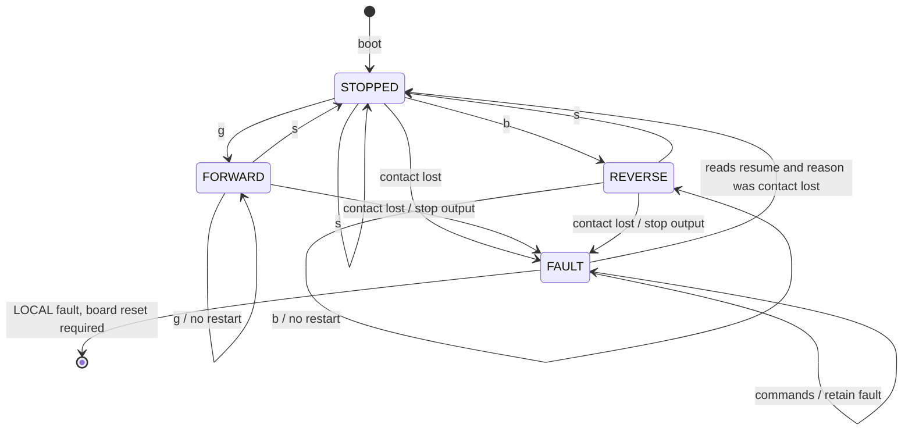

# Conveyor Arduino — motion

[Shared contract](../CONTRACT.md) · [Build instructions](../README.md#platformio)

Seed code is in place. Import the proven motor library, pins and speed from the working sketch into the motor section of `src/main.cpp`. Confirm reverse operation before integration. Do not upload the seed over working demonstration firmware without checking the motor section first.

## What this board owns

Stepping, direction, a cumulative step count and its own contact watchdog. It accepts `g`, `b` and `s`. It reports STOPPED, FORWARD, REVERSE or FAULT, a fault reason, uptime and the step count. It holds no process state. The master decides when movement starts and ends.

## Code layout

- `lib/conveyor_logic`: the state machine and the reply encoder. Pure C++, so the master's host tests run it directly.
- `src/main.cpp`: the motor section with three hooks, the Wire link and the publish loop.
- `../shared/slave_link.h`: Wire slave boilerplate shared with the sensing board.

The owner changes the motor section only: library, pins, steps per revolution and step interval. Keep the hooks: a step is emitted only when `motor()` asks for one, and every emitted step calls `countStep()` once. Do not reset the count on stop or reversal.

## States keyed to commands

Direct reversal is rejected: the master confirms STOPPED before the opposite command. There is no speed or reset command. Existing Serial `g/s/f/l` may remain in an explicit standalone bench mode; it must not compete with master commands, and bus loss must not select bench mode.

## Verification

Demonstrate both directions, responsive stop, repeated-command behaviour, rejected direct reversal, continuous step count, contact timeout, recovery to STOPPED when reads resume, and no motion without a new command. Measure stop latency under load and steps per millimetre on the assembled belt. No encoder or stall detection is assumed.
