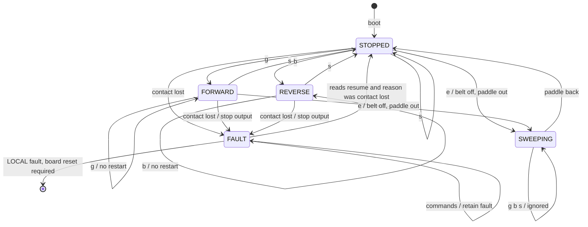

# Conveyor Arduino — motion

[Shared contract](../CONTRACT.md) · [Build instructions](../README.md#platformio)

The proven standalone sketch's motor driver is integrated: a 28BYJ-48 on a ULN2003, half-stepped directly from four pins, no library. Set the pins and `MM_PER_HALF_STEP` in `src/main.cpp` to the assembled rig.

## What this board owns

Stepping, the ejector paddle, a cumulative step count and its own contact watchdog. It accepts `g`, `s` and `e`, plus `b` for bench use. It reports STOPPED, FORWARD, REVERSE, SWEEPING or FAULT, a fault reason, uptime and the step count. It holds no process state. The master decides when movement starts, when the puck is ejected, and when movement ends.

## Code layout

- `lib/conveyor_logic`: the state machine and the reply encoder. Pure C++, so the master's host tests run it directly.
- `src/main.cpp`: the half-step driver, fixed-speed stepping, the ejector sweep, bench keys, the Wire link and the publish loop. `EJECTOR_ENABLED` defaults to 1; build with `-DEJECTOR_ENABLED=0` for a belt-only rig, where `e` completes immediately.
- `../shared/slave_link.h`: Wire slave boilerplate shared with the sensing board.

A step is emitted only when `motor()` asks for one, and every emitted half-step calls `countStep()` once. One contract step is one half-step. The coils are released whenever the belt is not stepping. Do not reset the count on stop or reversal.

## Wiring and settings

| Item | Value |
| --- | --- |
| Belt motor | ULN2003 IN1 to IN4 on D4, D5, D6, D7 |
| Ejector motor | ULN2003 IN1 to IN4 on D11, D10, D9, D8 |
| Sweep | 1024 half-steps out, 150 ms dwell, 1024 back, about 2.7 s |
| Step unit | half-step, 4096 per revolution |
| `MM_PER_HALF_STEP` | 0.0307 from the standalone sketch; re-measure with `c` |
| Belt speed | 15 mm/s fixed; the driver caps at about 1000 half-steps per second |
| Direction | flip `FORWARD_DIRECTION` if the belt runs backwards |

## Bench keys

Serial at 9600. `g`, `b`, `s` and `e` send the same commands the master sends and pass the same guards. `c` runs exactly 4096 half-steps then stops; measure the travel and set `MM_PER_HALF_STEP` to travel in millimetres divided by 4096. Bench keys are ignored while a master is polling the board, so they cannot interfere with a cycle; disconnect the bus or stop the master to use them.

## States keyed to commands

Direct reversal is rejected: the master confirms STOPPED before the opposite command. There is no speed or reset command. Existing Serial `g/s/f/l` may remain in an explicit standalone bench mode; it must not compete with master commands, and bus loss must not select bench mode.

## Verification

Demonstrate both directions, responsive stop, repeated-command behaviour, rejected direct reversal, continuous step count, contact timeout, recovery to STOPPED when reads resume, and no motion without a new command. Measure stop latency under load and half-steps per millimetre on the assembled belt with the `c` key. No encoder or stall detection is assumed.
