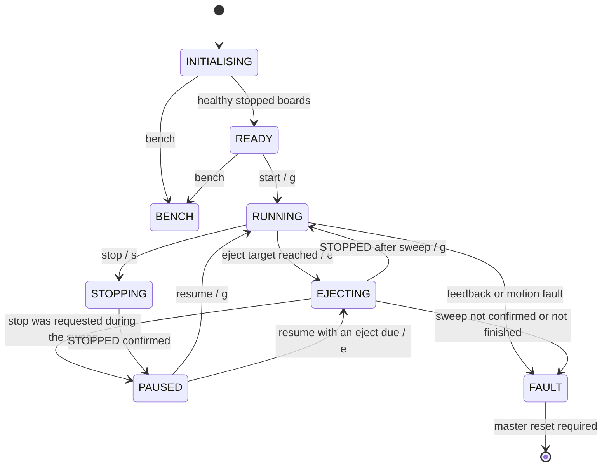

# Master Arduino — sorting coordination and system andon

[Shared contract](../CONTRACT.md) · [Build instructions](../README.md#platformio)

Implemented and host-tested against the real slave logic. The master owns puck classification, the eject queue, the counters and system faults. It does not step the motor or debounce sensors.

## Code layout

- `../shared/contract.h`: every number from CONTRACT.md as named constants. All three boards include it.
- `lib/feedback`: decodes and validates each reply, tracks freshness, counter regression, uptime stall and reboot. Pure C++.
- `lib/process`: the state machine below. Takes the two slave views, the operator command and the time; returns the commands to send. Pure C++.
- `src/config.h`: Serial baud, Wire timeout, andon pins and the calibration constants.
- `src/wire_link`: bounded Wire send and read.
- `src/operator_serial`: Serial command parsing and the status report.
- `src/main.cpp`: the 100 ms poll loop, Stop priority, andon output.
- `test/`: host tests. `test_process` feeds scripted contract bytes. `test_end_to_end` runs this master against the real conveyor and sensing logic on a simulated belt.

The pure modules compile unchanged for the Uno and for the host, so the tests cannot drift from the firmware.

```sh
pio run -d master
pio test -d master -e native
pio device monitor -d master --port /dev/cu.YOUR_BOARD --baud 115200
```

## Process rules in the code

The belt runs continuously. Each tick the master reads the two edge counts and the step count from the same poll. New channel 1 edges open presence windows stamped with the step count; new channel 2 edges close the oldest window as magnetic and queue an eject target; windows older than the channel spacing allowance close as safe. When the step count reaches the head of the queue the master sends `e`, waits for the sweep, pops the queue and restarts the belt. Windows and targets are step counts, so pauses do not disturb them.

A motion command is confirmed only by a reply received after it was sent. Stop has priority over any other operator command received in the same poll interval and discards it; every buffered Serial line is read before each poll. A slave reporting CONTACT_LOST in INITIALISING, READY or BENCH only blocks progress, since its next reads clear it; any other slave fault, in any state, faults the master. A faulted master keeps requesting stop whenever the belt reports motion. Notices print when they change, not every poll; every command send is printed, with repeated failures printed once.

## Serial commands

Commands end with newline. `start` is accepted only in READY, `resume` only in PAUSED. `stop` pauses the belt, or after the current sweep if one is running. `status` prints the report on demand. `help` lists the commands. There is no fault-clear command; reset the master.

`bench` enters BENCH from INITIALISING or READY. In BENCH the master keeps polling and reporting but runs no process logic and raises no faults. `send c g` sends `g` to the conveyor. `stop` still sends `s`. Leave BENCH by resetting the master. Use it to test one slave at a time and to measure calibration.

The report prints on every state change and once a second. Each slave shows current state, fault, feedback age and UNKNOWN or INVALID when feedback is missing or fails validation, the sensing board also its two signal levels. The report ends with the counters: safe, magnetic, ejected, unmatched when nonzero, the pending windows and ejects, and the steps until the next eject. A channel line with the current step count prints whenever a live bit or an edge count changes.

## Calibration

Start is refused until `CHANNEL_SPACING_STEPS` and `PADDLE_STEPS` in `src/config.h` are nonzero and below half the counter range. The spacing allowance is the light-sensor-to-Hall distance in half-steps plus margin; a magnetic puck's Hall edge must arrive inside it. The paddle distance is the Hall-to-paddle distance in half-steps; measure it by running a magnetic puck in BENCH and reading the step count at the Hall edge and at the paddle. `STEPS_PER_MM` only adds millimetres to the report.

## Andon

Amber blinking in INITIALISING while waiting for the slaves. Off in READY and BENCH. Green while running, stopping or sweeping. Amber steady in PAUSED. Red in FAULT. Pins and blink period are in `src/config.h`; set the pins to the wiring.

## States

| State | Responsibility |
| --- | --- |
| INITIALISING | Request stop; require fresh STOPPED and sensing OK. Absent slaves wait here without fault. |
| READY | Wait for Start. |
| RUNNING | Belt forward; classify pucks, maintain the queue, send `e` when an eject is due. |
| STOPPING | Send `s` each poll until STOPPED is confirmed, then PAUSED. |
| EJECTING | Belt paused by the conveyor; confirm SWEEPING, wait for STOPPED, pop the queue, restart the belt. |
| PAUSED | Keep polling; windows, queue and counters retained. |
| BENCH | Poll and report only; forward raw operator sends. Reset to leave. |
| FAULT | Request stop until a post-fault reply confirms rest, and again whenever motion is reported; retain reason until master reset. |



## Verification

Host tests cover start and stop, safe and magnetic classification, several pucks queued in arrival order, two pucks closer than the channel spacing, a magnetic edge with no presence window, pause and resume with a queued eject, stop during a sweep, sweep confirmation and timeout, stale replies that must not confirm a stop, stop retry and STOP UNCONFIRMED, fault requests that continue without feedback, lost and invalid feedback, slave faults and contact loss, reboot handling, unexpected motion, queue overflow and bench mode. The end-to-end tests run the master against the real slave logic with four mixed pucks on a simulated belt, pause and resume, a safe-only run, slave watchdogs and master reset recovery.

Still to record on hardware: the channel spacing allowance, the Hall-to-paddle distance, the light sensor threshold in the demo room, and continuous runs with several pucks. Host tests and compilation do not verify mechanical behaviour.
