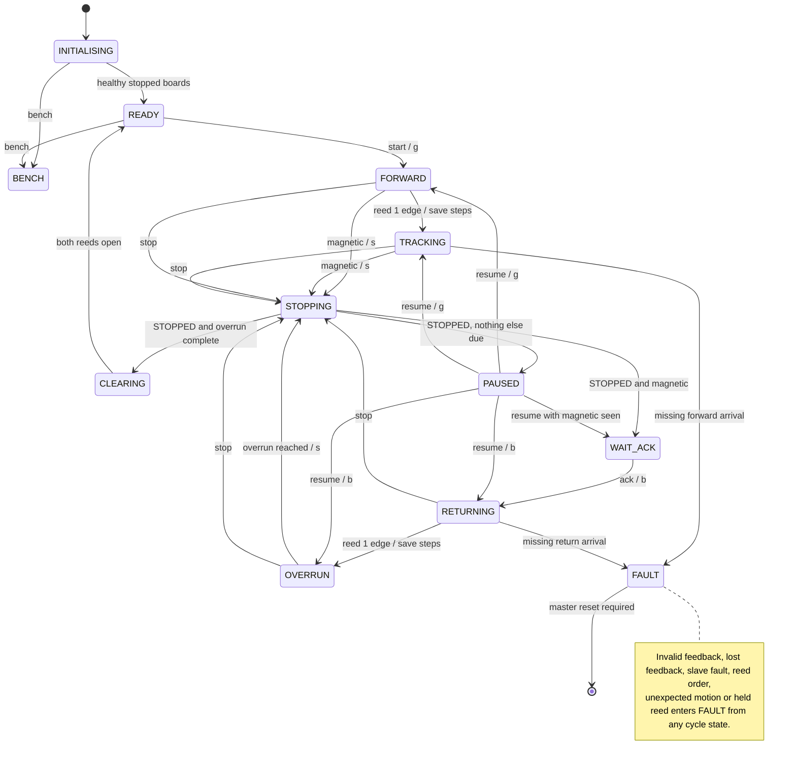

# Master Arduino — process coordination and system andon

[Shared contract](../CONTRACT.md) · [Build instructions](../README.md#platformio)

Implemented and host-tested against the real slave logic. Not yet exercised on hardware. The master owns every phase, baseline, allowance, acknowledgement and system fault. It does not step the motor or debounce reeds.

## Code layout

- `../shared/contract.h`: every number from CONTRACT.md as named constants. All three boards include it.
- `lib/feedback`: decodes and validates each reply, tracks freshness, counter regression, uptime stall and reboot. Pure C++.
- `lib/process`: the state machine below. Takes the two slave views, the operator command and the time; returns the commands to send. Pure C++.
- `src/config.h`: Serial baud, Wire timeout, andon pins and the calibration constants.
- `src/wire_link`: bounded Wire send and read.
- `src/operator_serial`: Serial command parsing and the status report.
- `src/main.cpp`: the 100 ms poll loop, Stop priority, andon output.
- `test/`: host tests. `test_process` feeds scripted contract bytes. `test_end_to_end` runs this master against the real conveyor and sensing logic on a simulated belt.

The pure modules compile unchanged for the Uno and for the host, so the tests cannot drift from the firmware.

```sh
pio run -d master
pio test -d master -e native
pio device monitor -d master --port /dev/cu.YOUR_BOARD --baud 115200
```

## Process rules in the code

State handlers never read the slave views. Each tick computes one `Observation` from the views and the saved baselines: arrived, magnetic, reed order, returned, overdue and overrun complete. Progress checks run on that observation in every cycle state, including STOPPING and PAUSED, before any operator command is handled. Resume uses the same observation to pick the next motion. This is what keeps pause, stop and resume from disagreeing.

A motion command is confirmed only by a reply received after it was sent. Step baselines are taken only from a conveyor reply in the same poll as the reed event. Stop has priority over any other operator command received in the same poll interval and discards it. A slave reporting CONTACT_LOST in INITIALISING, READY or BENCH only blocks progress, since its next reads clear it; any other slave fault, in any state, faults the master. Notices print when they change, not every poll.

## Serial commands

Commands end with newline. `start` is accepted only in READY, `resume` only in PAUSED, `ack` only in WAIT_ACK and only while reed 1 reads open. `stop` pauses any moving phase. `status` prints the report on demand. `help` lists the commands. There is no fault-clear command; reset the master.

`bench` enters BENCH from INITIALISING or READY. In BENCH the master keeps polling and reporting but runs no process logic and raises no faults. `send c g` sends `g` to the conveyor. `stop` still sends `s`. Leave BENCH by resetting the master. Use it to test one slave at a time and to measure calibration.

The report prints on every state change and once a second. Each slave shows current state, fault, feedback age and UNKNOWN or INVALID when feedback is missing or fails validation. The conveyor also shows its target state. A reed line with the current step count prints whenever a live bit or an edge count changes. Travel shows estimated steps against the active allowance.

## Calibration

Start is refused until `FORWARD_ALLOWANCE_STEPS`, `RETURN_ALLOWANCE_STEPS` and `DISCHARGE_OVERRUN_STEPS` in `src/config.h` are nonzero. Measure them in BENCH on the assembled belt: run the conveyor with raw sends, read the step count printed at each reed change, and add margin for polling, debounce and stopping distance. `STEPS_PER_MM` only adds millimetres to the report.

## Andon

Off in INITIALISING, READY and BENCH. Green while a cycle is moving or stopping. Amber in WAIT_ACK and PAUSED. Red in FAULT. Pins are in `src/config.h`; set them to the wiring.

## States

| State | Responsibility |
| --- | --- |
| INITIALISING | Request stop; require fresh STOPPED, sensing OK and both reeds open. Absent slaves wait here without fault. |
| READY | Wait for manual loading and Start. Start saves both reed edge counts and sends `g`. |
| FORWARD | Run until a reed 1 edge. No arrival has no deadline. |
| TRACKING | Step baseline saved at arrival; check travel to reed 2. |
| STOPPING | Send `s` each poll; confirm STOPPED; then WAIT_ACK, CLEARING or PAUSED from the observation. |
| WAIT_ACK | Magnetic detected and stopped; wait for Ack. Ack saves the return baselines and sends `b`. |
| RETURNING | Check travel to a new reed 1 edge. |
| OVERRUN | Continue reverse for the calibrated steps from the return edge. |
| CLEARING | Stopped; require both reeds open within 300 ms; then READY. |
| PAUSED | Keep polling; retain phase and baselines. |
| BENCH | Poll and report only; forward raw operator sends. Reset to leave. |
| FAULT | Send `s` until a post-fault reply confirms rest; retain reason until master reset. A master reset recovers, because slaves clear CONTACT_LOST themselves once polling resumes. |



## Verification

Host tests cover the complete cycle, both reeds in one poll, reed order, missing forward and return arrival, event priority over the travel limit, pause in each phase, events during stopping, stale replies that must not confirm a stop, stop retry and STOP UNCONFIRMED, fault requests that continue without feedback, lost and invalid feedback, counter regression, slave faults, confirmation timeouts, reboot handling, held reeds, Ack blocked by reed 1, unexpected motion, baselines deferred to a same-poll conveyor reply, limits exceeded during stopping, and bench mode. The end-to-end tests run the master against the real slave logic for a full cycle, pause and resume, a non-magnetic puck, slave watchdogs and a short allowance.

Still to record on hardware: calibrated allowances, actual stopping distance, Wire timing with real boards, and the full demonstration sequence. Host tests and compilation do not verify mechanical behaviour.
